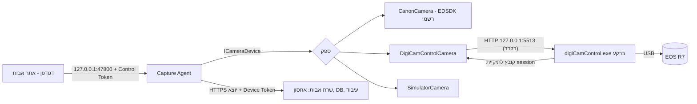

# digiCamControl כספק מצלמה — ממצאים, ארכיטקטורה ומגבלות

מסמך זה מתעד את בדיקת האפשרות לשלוט ב-Canon EOS R7 דרך [digiCamControl](https://github.com/dukus/digiCamControl) (קוד פתוח, רישיון MIT) בלי להמתין לגישה ל-Canon EDSDK הרשמי. **מה שלא נבדק מול חומרה מסומן במפורש.**

## 1. איך הצילום עבד לפני השינוי
- ממשק אחיד `ICameraDevice` (`AvotCapture.Core`) — מומש ע"י `CanonCamera` (EDSDK) ו-`SimulatorCamera`.
- `CaptureCoordinator` מקבל בקשת צילום מהדפדפן (בדרך `/v1/capture` ב-Agent המקומי), "קובע" את הספר/הקטגוריה ברגע הלחיצה, יורה את התריס, משייך קבצים נכנסים לבקשות לפי סדר (FIFO), שומר לדיסק + SHA-256 + SQLite, ו-`UploadQueue` מסנכרן לשרת.
- הדפדפן מדבר רק עם `http://127.0.0.1:47800` (הרשאת Control Token חתום + Lease יחיד) והשרת רק מקבל העלאות מה-Agent (חיבור יוצא).

## 2. מה השתנה
ספק חדש `AvotCapture.DigiCam.DigiCamControlCamera` שמממש את אותו `ICameraDevice`. שום דבר מלמעלה (Coordinator, תור העלאה, API מקומי, ממשק) אינו יודע איזה ספק פעיל. **ספק Canon EDSDK לא הוסר** — החלפה בעתיד נעשית בבחירת מצב.

מצבי מצלמה (`CameraMode` ב-`settings.json`, או בתפריט המגש / `--camera`):
| מצב | התנהגות |
|---|---|
| `AUTO` (ברירת מחדל להתקנה חדשה) | Canon EDSDK אם קובצי ה-DLL מותקנים, אחרת digiCamControl |
| `DIGICAM` | digiCamControl בלבד |
| `CANON` | EDSDK בלבד (כמו קודם) |
| `SIMULATOR` | בדיקות בלבד |

## 3. מה digiCamControl מאפשר (מתועד) ומה ממומש
מקורות: [Web Interface](https://www.digicamcontrol.com/doc/userguide/web), [Single Command System](https://digicamcontrol.com/doc/userguide/singlecmd). שרת ה-Web כבוי כברירת מחדל: *Settings ← Webserver ← Use web server* (פורט 5513).

| דרישה | פקודה | מימוש | הערות |
|---|---|---|---|
| צילום | `?slc=capture` | ✔ | הקובץ נשמר בתיקיית ה-session שה-Agent קבע (`set session.folder`) |
| צילום ללא AF | `?slc=capturenoaf` | ✔ (מתג ״צילום ללא פוקוס אוטומטי״) | |
| Live View התחלה/עצירה | `?CMD=LiveViewWnd_Show` / `LiveViewWnd_Hide` + `/liveview.jpg` | ✔ | ראו מגבלה 1 |
| ISO, תריס, צמצם, איזון לבן, פיצוי חשיפה, מצב פוקוס, איכות/פורמט (RAW/JPEG) | `list <prop>` / `get` / `set` | ✔ | **מוצגות רק אפשרויות ש-`list` החזיר** (נבדק מול mock שאינו מדווח איזון לבן → לא מוצג) |
| מצב צילום (גלגל) | `get mode` | קריאה בלבד | לא ניתן לשנות מהמחשב |
| פוקוס אוטומטי | `do LiveView_Focus` | ✔ רק בזמן Live View, ורק אם הפקודה מופיעה ב-`list cmds` | |
| פוקוס ידני בצעדים | פקודות `LiveView_Focus_*` שב-`list cmds` | ✔ כפתורים לפי מה שנמצא בפועל | שמות הפקודות לא אומתו מול גרסה אמיתית — נגזרים דינמית |
| סטטוס חיבור | `list cameras` כל 2 שניות | ✔ מנותק/מחובר/מצלם/מעבד | |
| קבלת הקובץ | ניטור תיקיית ה-session → המתנה לגודל יציב + נעילה → העברה ל-staging | ✔ | תומך גם בכפתור הצילום שבגוף המצלמה |
| RAW+JPEG | שני קבצים לצילום אחד | ✔ | נספר רק כשה-quality מכיל גם RAW וגם JPEG |

## 4. תלות ב-Canon EDSDK — תשובה ישירה
**קוד פתוח ≠ עצמאות מה-SDK.** digiCamControl משתמש ב-Canon EDSDK כדי לדבר עם מצלמות Canon (בקוד: `Canon.Eos.Framework`; בהיסטוריה: ״Updated canon sdk״, ״Update to latest EDSDK version״). לכן:
- **אצלנו**: אין תלות בקובצי Canon. הפרויקט לא כולל ולא מפיץ EDSDK ולא digiCamControl (`build-installer.ps1` ממשיך להסיר EDSDK). digiCamControl מותקן בנפרד בעמדה, על אחריות ובתנאי הרישיון שלו (MIT לקוד; רכיבי Canon בתוכו כפופים לתנאי Canon). **לפני הפצה של חבילה שכוללת את digiCamControl יש לבדוק את תנאי הרישיון של רכיבי Canon שבה.**
- **בפועל**: תמיכה ב-R7 תלויה בגרסת ה-EDSDK שבתוך ה-build של digiCamControl שתותקן. הפרויקט פעיל (קומיטים בשבועות האחרונים) אך הגרסה היציבה האחרונה בעמוד ה-Releases ישנה; חיפוש ״R7״ ב-Issues לא החזיר דיווחים — **זו אינה הוכחה לתמיכה או לאי-תמיכה**. נדרש ניסוי עם המצלמה (סעיף ג׳ ב-[hardware-acceptance.md](hardware-acceptance.md)). אם R7 אינה נתמכת בגרסה שהותקנה, ה-Agent מציג ״digiCamControl פועל אך לא זיהה מצלמה״, מצב `CANON` נשאר זמין, וזרימת העבודה הקיימת לא נפגעת.

## 5. מגבלות ידועות (לא להסתיר)
1. **חלון Live View**: `LiveViewWnd_Show` פותח את חלון ה-Live View של digiCamControl, והתוכנה חייבת לרוץ (אפשר ממוזערת, לא חייבת בחזית; ה-Agent מפעיל אותה אוטומטית אם `DigiCamAutoLaunch` ונמצא `CameraControl.exe`). האם `/liveview.jpg` ממשיך לספק פריימים כשהחלון ממוזער — **לא נבדק**.
2. **צילום בזמן Live View**: לפי התיעוד ״capture פשוט לא עובד בכל הדגמים״ — ה-Agent מנסה `capture` ואם נכשל עובר ל-`LiveView_Capture`. התנהגות R7 — לא נבדקה.
3. **פורמט תשובות `list`/`get`**: הקוד סובל שורות או רשימה מופרדת בפסיקים, אך הפורמט המדויק של גרסה אמיתית לא נבדק (ה-mock נבנה מהתיעוד).
4. **RAW בלבד**: אין JPEG לעיבוד/חיתוך; הממשק מזהיר.
5. **קבצים שנשארו בתיקיית ה-session** מהפעלה קודמת מועברים ל-`_leftover` ולא משויכים לעולם לספר (מניעת שיוך שגוי).
6. **Throughput**: כל צילום ≈ זמן ההעברה ב-USB + יציבות הקובץ (~0.5 שנ׳). `Save_to_PC_and_camera` (שמירה גם בכרטיס) אפשרי בהגדרה `DigiCamTransfer`.

## 6. אבטחה
- כתובת digiCamControl **חייבת** להיות loopback (`http://127.0.0.1:<port>`); כתובת אחרת נדחית בבנאי.
- הדפדפן לעולם לא מדבר עם digiCamControl: רק ה-Agent, והוא מגן עליו בהרשאת Control Token + Origin + Lease.
- בכל חיבור ה-Agent בודק אם פורט digiCamControl נגיש גם מכתובת ה-LAN של המחשב, ואם כן מציג **אזהרת אבטחה** (במגש/סטטוס) — יש לחסום את הפורט בחומת האש של Windows (Inbound). אין צורך בפתיחת פורטים לאינטרנט.
- ה-Agent נשאר יוצא בלבד לשרת (HTTPS) — לא נוספה חשיפה חדשה.

## 7. הגדרת עמדה
1. התקינו digiCamControl (digicamcontrol.com), חברו את R7 ב-USB, הדליקו. סגרו EOS Utility.
2. ב-digiCamControl: *Settings ← Webserver ← Use web server* (פורט 5513) ← OK.
3. חסמו Inbound לפורט 5513 בחומת האש.
4. ב-Agent: מגש ← מצב מצלמה ← ״אוטומטי״ או ״digiCamControl״ (או `AvotCaptureAgent.exe --camera DIGICAM`).
5. הגדרות מתקדמות ב-`%LOCALAPPDATA%\AvotCapture\settings.json`: `DigiCamUrl`, `DigiCamExePath`, `DigiCamAutoLaunch`, `DigiCamTransfer`.
6. במסך הצילום: בחרו ״Canon EOS R7 … (דרך digiCamControl)״. פורמט מומלץ: JPEG או RAW+JPEG.
